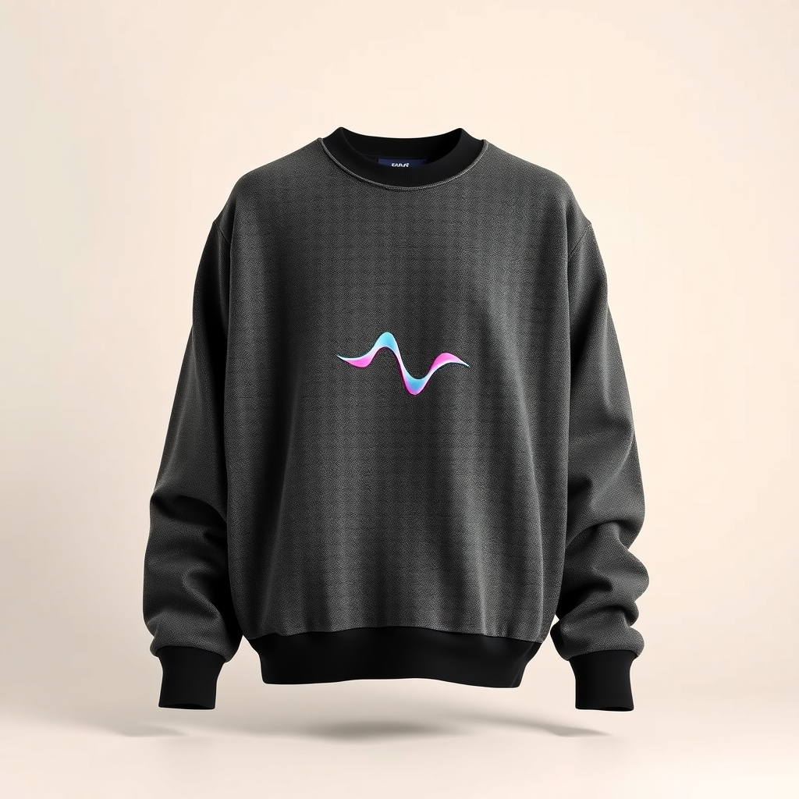
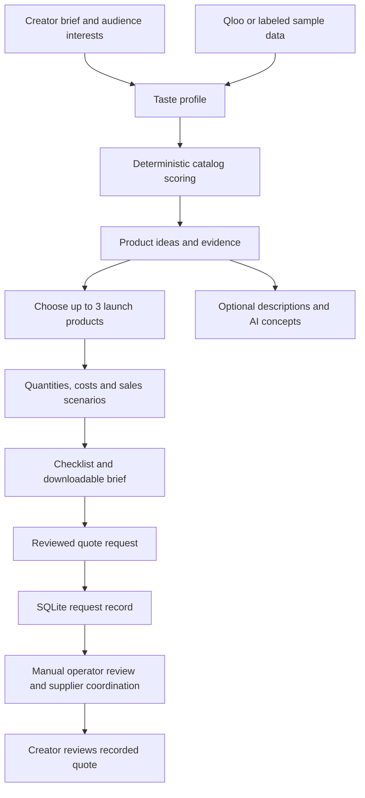

<div align="center">

<a id="top"></a>

# 🎛️ MerchDesk

### Your first merch drop, without betting blind.

Turn audience taste into a focused collection, understandable money math, and a supplier quote request.

**Built for independent musicians · Designed around an India pilot · Human-coordinated production**


[🚀 Run locally](#run-locally) · [🧭 Take a tour](#take-a-tour) · [🔎 Understand the decisions](#understand-the-decisions) · [🛠️ Developer guide](#developer-guide)

</div>

---

## 💡 From “my fans want merch” to a launch you can explain

You have a release coming up. Fans ask for a tee. Someone suggests totes. Now you need to decide what fits your audience, how much stock to order, and how much cash you could tie up.

MerchDesk brings those decisions into one workspace: describe your fans, review the evidence behind product ideas, build a **1–3 product launch**, and compare the costs before requesting a quote.

| You bring | MerchDesk helps you build |
| --- | --- |
| Your audience's interests and cultural references | A taste profile and product recommendations with supporting evidence |
| Your city, budget, artwork status, and launch purpose | A small assortment with quantities, specifications, and price assumptions |
| Your own estimate of likely sales | Conservative, base, and optimistic scenarios with upfront cash and unsold-stock exposure |
| Your reviewed plan | A downloadable brief, production checklist, and trackable quote request |

> **Pilot reality:** supplier coordination is manual. Costs are estimates until confirmed in a written quote. Submitting a request does not trigger manufacturing or collect payment.

<a id="run-locally"></a>

## 🚀 Run locally

Use **Node.js 20.9+** and npm. Bun is also supported by the repository's `bun.lock`; the commands below use npm for a familiar setup.

```bash
git clone https://github.com/Kanishkp19/merch_desk.git
cd merch_desk
npm install
cp .env.example .env
mkdir -p db
npm run db:generate
npm run db:push
npm run dev
```

Open **[localhost:3000](http://localhost:3000)**. The example environment selects `fixtures`, so you can explore the sample-data experience without supplying an audience-data API key. AI image generation requires a working provider.

> Already have a local `.env`? Keep it and add any missing settings from `.env.example` instead of overwriting it. Run `db:push` against your local development database; the script includes `--accept-data-loss`.

<details>
<summary><strong>⚡ Want the fastest first look?</strong></summary>

After starting the server, open **[the sample launch](http://localhost:3000/#example)**. It uses a labeled example plan built with the same economics engine as real drafts.

Try changing quantities and sales assumptions in your own launch, then compare the economics tabs. You can inspect the sample before connecting Qloo or an image provider.

</details>

<a id="take-a-tour"></a>

## 🧭 Take a tour

These links open your **local running app**, not a hosted deployment.

| Stop | What to try |
| --- | --- |
| [🏠 Home](http://localhost:3000/) | Read the pilot scope and start a new brief. |
| [📝 Creator brief](http://localhost:3000/#brief) | Capture launch purpose, city, budget, audience evidence, and artwork readiness. |
| [🎛️ Studio](http://localhost:3000/#studio) | Review a taste profile, build a collection, compare products, and request concept images. Start with a brief for useful context. |
| [📦 Launch builder](http://localhost:3000/#launch) | Build an assortment, edit quantities, explore economics, and prepare a quote request. |
| [🧪 Sample launch](http://localhost:3000/#example) | Explore a clearly labeled example without creating a plan first. |
| [📬 My launches](http://localhost:3000/#launches) | Return to device-local drafts and track submitted requests. |
| [🖨️ Line sheet](http://localhost:3000/#line-sheet) | Print a collection or save it as a PDF after building one in Studio. |
| [🗂️ Operator queue](http://localhost:3000/#operator) | Review submitted requests with the configured pilot operator key. |

<details>
<summary><strong>🎸 Try this audience brief</strong></summary>

> Bengaluru indie electronic producer; fans love live gigs, analog photography, gig posters and filter coffee.

1. Start a brief and add your city, budget, and upcoming release or gig.
2. Use the description above as audience context, then inspect the taste profile.
3. Build a collection and read the evidence behind each recommendation.
4. Choose up to three products for a launch and edit quantities and prices.
5. Compare sales scenarios. Mark unknown supplier or shipping costs honestly.
6. Download the launch brief or review and submit a quote request.

The Studio also includes example prompts for comics, podcasts, and Chennai rap audiences; the current launch pilot focuses on independent musicians.

</details>

<details>
<summary><strong>🎨 Peek at an AI concept from the project artifacts</strong></summary>



An illustrative concept from a recorded run. AI concepts help communicate direction; final print-ready artwork and sample approval are separate checklist steps.

</details>

<a id="understand-the-decisions"></a>

## 🔎 Understand the decisions

### The journey, end to end



### Why this product?

Product fit is calculated in code. The LLM can help describe a product; it does not set the fit score or decide the economics.

```text
Fit score = round(100 × (0.50 × tag fit
                      + 0.30 × brand fit
                      + 0.20 × cross-domain fit))
```

Each component is normalized to `0…1`. Evidence links show the matching interests and their contributions. Estimated brand signals receive a discount; products below the **30/100 recommendation floor** are withheld. Sparse audience evidence can produce an empty collection and a request for more context.

Inspect the implementation: [scoring](src/lib/score/score.ts), [selection rules](src/lib/score/rules.ts), and [collection builder](src/lib/score/collection.ts).

### What happens if fewer people buy?

The economics engine stores money in **integer paise**, converts values for the rupee UI, and keeps unknown costs visible. It separates contribution from final profit and shows the cash tied up in unsold inventory.

| Scenario | Starting point |
| --- | --- |
| Conservative | 60% of your expected unit sales |
| Base | 100% of your expected unit sales |
| Optimistic | 130% of your expected unit sales |

These are adjustable planning inputs around your own sales estimate, with sales limited by available stock. They are **scenarios, not demand predictions**. Review supplier costs, setup, packaging, shipping, fees, and defects before treating an outcome as complete.

Inspect the [economics engine](src/lib/economics/engine.ts) and [input schema](src/lib/economics/schema.ts).

### What is live, sample, or manual?

| Capability | How it works |
| --- | --- |
| Audience research | Qloo when configured; fixture mode uses labeled sample data. |
| Product selection and economics | Deterministic TypeScript logic. |
| Product descriptions | LLM providers with a template fallback. |
| Concept images | Provider-dependent AI generation with quotas and moderation handling. |
| Local venue ideas | Research leads with source links; they do not imply partnerships. |
| Quote handling | Persisted requests, manual operator coordination, and creator review. |
| Production and payments | Outside the automated pilot workflow. No checkout or automatic manufacturing. |

## 🔌 Connect optional services

Edit your local `.env` and restart the development server. Keep credentials on the server; never add them to client code or commit them.

| Variable | Purpose |
| --- | --- |
| `DATABASE_URL` | SQLite connection. The example uses `file:../db/custom.db`. |
| `MERCHDESK_DATA_MODE` | `fixtures`, `live`, or `auto`. The example chooses `fixtures`; `auto` selects live mode when a Qloo key is present. |
| `QLOO_API_KEY` | Enables Qloo audience research; choose `live` or `auto` to use it. |
| `GROQ_API_KEY` | Optional Groq text generation. |
| `GEMINI_API_KEY` | Optional Gemini text and image generation. |
| `CF_ACCOUNT_ID` + `CF_API_TOKEN` | Optional Cloudflare text and image generation. |
| `LLM_PROVIDERS` | Text-provider order; defaults to `zai,groq,gemini,cloudflare`. Z.ai availability depends on the runtime. |
| `OPERATOR_KEY` | Shared pilot key for the operator queue. The queue is disabled when this is unset. |
| `NEXT_PUBLIC_MAX_IMAGES_PER_SESSION` | Image allowance per session; defaults to `12`. This value is public. |

See [.env.example](.env.example) for a starting template and [environment parsing](src/lib/env.ts) for model and provider overrides.

<details>
<summary><strong>🗃️ Where does my work live?</strong></summary>

| Data | Storage |
| --- | --- |
| Studio session | Browser `sessionStorage` |
| Creator brief and launch drafts | Browser `localStorage`, on that device |
| Generated image bytes | Browser IndexedDB |
| Submitted quote requests and operator updates | Server-side SQLite through Prisma |

Clearing browser storage removes local work. Local drafts do not sync across devices. Persist the SQLite file if you deploy the request workflow.

The operator key is a shared pilot gate, not an account system. User accounts, full authentication, payment collection, and supplier integrations are outside the current pilot.

</details>

<a id="developer-guide"></a>

## 🛠️ Developer guide

### Find your way around

```text
src/
├── app/api/          Research, collection, image, launch and operator endpoints
├── components/      Landing, Studio, launch builder, views and print layouts
├── data/            Catalog, palettes and canonical taste tags
└── lib/
    ├── agent/       Taste-profile research orchestration
    ├── score/       Product fit, selection, pricing and drop planning
    ├── economics/   Launch costs, sales scenarios and break-even logic
    ├── launch/      Drafts, checklists, quote snapshots and brief export
    ├── qloo/        Audience-data integration and normalization
    ├── llm/         Text providers and prompts
    ├── image/       Concept generation, quotas and browser storage
    └── partners/    Local venue research leads
prisma/              SQLite schema
scripts/             Data validation, provider probes and benchmark tooling
tests/               Vitest tests and fixtures
artifacts/           Recorded benchmark and browser-run outputs
```

The UI uses a single app shell with [hash-based navigation](src/lib/routes.ts). The backend runs on Next.js route handlers, validates data with Zod, and uses Prisma for submitted launch requests.

### Useful commands

| Command | Purpose |
| --- | --- |
| `npm run dev` | Start development on port 3000. |
| `npm run db:generate` | Generate the Prisma client. |
| `npm run db:push` | Apply the schema to your development database; permits data loss. |
| `npx vitest run tests/economics.test.ts tests/pricing.test.ts` | Run focused economics and pricing checks. |
| `npx tsc --noEmit` | Check TypeScript separately. |
| `npm run lint` | Run the repository ESLint script. |
| `npm run build` | Build and prepare the standalone Next.js output. |
| `npm run start` | Start the production server; the current script requires Bun. |

The Next.js config currently allows builds despite TypeScript errors, so run the explicit type check when validating code changes.

### Read deeper

- [India pilot notes](docs/INDIA_PILOT.md) — pricing evidence, venue outreach status, and launch acceptance criteria.
- [Implementation map](docs/IMPLEMENTATION_MAP.md) — historical build notes and recorded verification; some sections describe the pre-pilot state.
- [Working assumptions](docs/ASSUMPTIONS.md) — assumptions behind the pilot.
- [Benchmark rubric](artifacts/benchmark/RUBRIC.md) — how recorded recommendation runs were reviewed.

<details>
<summary><strong>🧯 Troubleshooting</strong></summary>

**The page says it is using sample data.** Check `MERCHDESK_DATA_MODE`. To connect audience research, configure `QLOO_API_KEY`, choose `live` or `auto`, and restart the server.

**No products appear.** Add specific audience interests. The collection builder can withhold products when evidence is sparse or the fit is below its floor.

**Images are unavailable.** Configure a supported image provider and check its quota. Fixture mode provides audience data, not an image-generation service.

**Quote submission fails with a database error.** Ensure `db/` exists, check `DATABASE_URL`, and run `npm run db:generate` followed by `npm run db:push` against your development database.

**The operator queue is unavailable.** Set `OPERATOR_KEY`, restart the server, and supply the same key in the operator UI.

**A draft disappeared on another browser.** Drafts belong to the device and browser where you created them. Export the brief before clearing browser storage.

</details>

---

<div align="center">

**Start with your fans. Make the assumptions visible. Build a drop you understand.**

[Explore the sample locally](http://localhost:3000/#example) · [Report an issue](https://github.com/Kanishkp19/merch_desk/issues) · [Back to top](#top)

</div>
